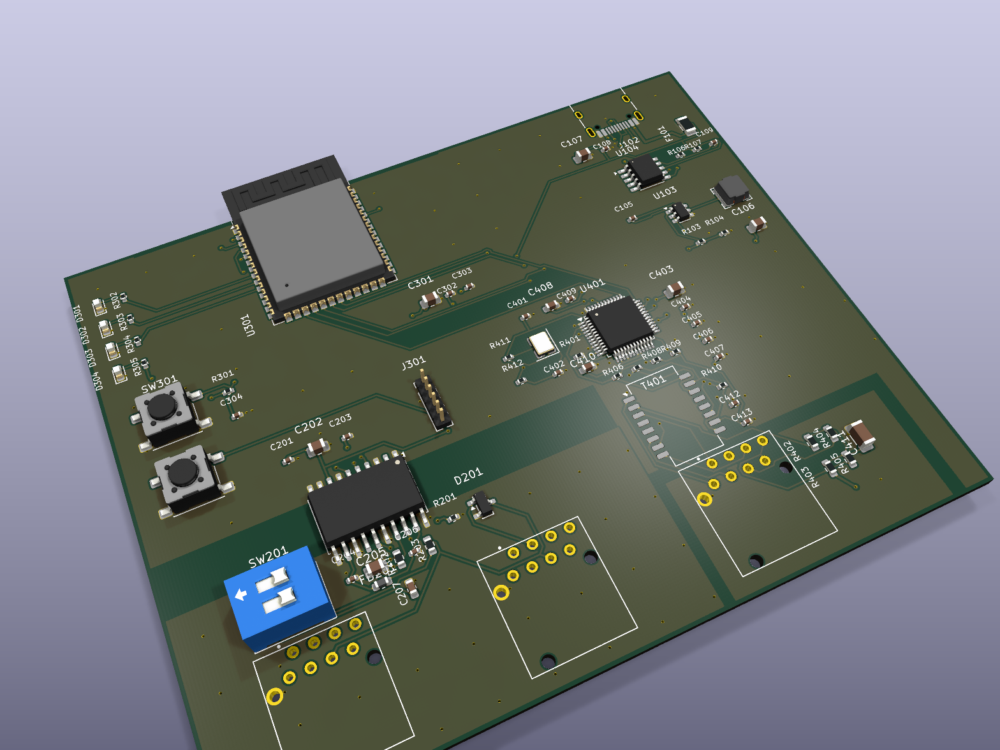

# CANary

> **AI-assisted project.** This codebase was created with [Claude](https://claude.com/claude-code)
> (Anthropic), directed and reviewed by a human author.

An open-hardware **IP-to-CAN converter compatible with the d&b audiotechnik R70
Ethernet-to-CAN interface**. It speaks the R70's network protocol, so **R1** can
find it, connect to it and reach CAN-era d&b amplifiers (D6, D12, E-PAC) through
hardware you can build yourself.

**ESP32-S3 · W5500 Ethernet · ADM3053 isolated CAN · USB-C PD power · three
Neutrik etherCONs**, in a one-piece 3D-printed case. A second variant of the
same design, the **CANary Dev Edition**, adds PoE and brings the board's
insides out to a front-panel header ([two variants](#two-variants)).

<p align="center">
  
</p>

> **Status: prototype.** **CANary (rev A)** boards have been built. Board #1 passes its
> self-test, takes a DHCP lease, and is discovered and listed by R1 over
> Ethernet. The host-side acceptance run passes 19/19 over Ethernet and over the
> USB network link. On 2026-10-28 it went on a real bus with two d&b amplifiers:
> both answered through the isolation barrier on both CAN jacks, and the control
> application connected through the board and drove mute and gain in both
> directions ([bring-up log §12](hardware/fab/test/BRINGUP-LOG-0001.md)).
> **Not yet done:** after a CAN cable pull the CAN side stayed deaf until the
> board was reset. A fix exists in development firmware, but it is not yet in
> this repository or any release, and has not been re-run on a board. LAN pulls,
> amplifier power cycles and long runs are untested, and only one board has been
> tried. Treat it as a development platform, not show equipment.
>
> **CANary Dev Edition (rev B)** is designed and routed (DRC 0 errors, 0
> unconnected) and its fab packages are made, but it has **never been ordered,
> built or powered**. Nothing about rev B, PoE included, is proven on hardware.

## Two variants

One design, two boards. Rev B is rev A with additions: the same ESP32-S3, W5500,
isolated CAN, USB-C PD input and three etherCONs, with a few parts swapped for
PoE (below). It is generated from rev A's routed board, keeping rev A's routing
and checking it is still on the expected nets ([REV-B.md](hardware/rev-b/REV-B.md)).

| | **CANary** (rev A) | **CANary Dev Edition** (rev B) |
|---|---|---|
| In short | the simple board: self-contained, made for the desktop tube case | rev A with its insides brought out, for a 1U rack box or an enclosure of your own |
| Files | [`hardware/`](hardware/) | [`hardware/rev-b/`](hardware/rev-b/REV-B.md), and the front-panel board in [`hardware/frontpanel/`](hardware/frontpanel/README.md) |
| Board | 100 × 81 mm, 4 layers | the same outline and stackup |
| Power | USB-C PD, 5 V | 802.3af PoE (SDAPO DP9900M-5V module) or a 5 V aux input (DNP pads), either taking priority over USB-C PD through a TPS2116 power mux |
| Module | ESP32-S3-WROOM-1-N8, no PSRAM | ESP32-S3-WROOM-1-N8R2, 2 MB of quad PSRAM (no firmware uses it yet) |
| Front panel | the board's own LEDs and buttons, through the case | keyed 16-way header J501: buffered LED sinks, RESET, BOOT, I2C, two spare GPIOs. A separate 84 × 26 mm front-panel board takes it on a ribbon |
| Extra pads (DNP) | none | CAN bus, remote termination switch, USB data, 5 V aux in |
| Ethernet magnetics | PT61017PEL | B1608S (PoE+ rated, same footprint); Bob Smith termination DC-blocked so PoE detection can work |
| Mounting | none: the board slides into the case's rails | four M3 holes |
| Status | built; board #1 works (above) | designed, routed, fab packages made; never ordered, built or powered |

The LEDs and buttons are on the same GPIOs on both, so today's firmware images
should run on rev B unchanged; with no rev B board, that has not been tried. To
build one now, build rev A. Rev B is for anyone who needs PoE, a rack front
panel or the spare I/O and is willing to go first: read REV-B.md's
[checks before ordering](hardware/rev-b/REV-B.md#what-to-check-before-ordering)
before spending anything. The PoE module's footprint, for one, has not been
compared with a real module.

## What is in this repo

| Path | What |
|---|---|
| [`hardware/`](hardware/) | Rev A board (**CANary**): KiCad 10 project (4 sheets, 100 × 81 mm, 4 layers), symbol/footprint library, fab outputs (Gerbers, BOM, pick-and-place, interactive BOM) and the design scripts that placed and routed it |
| [`hardware/rev-b/`](hardware/rev-b/) | Rev B board (**CANary Dev Edition**): KiCad 10 project (5 sheets), generic and JLCPCB fab packages, the scripts that generate it from rev A's board, and the write-up, [REV-B.md](hardware/rev-b/REV-B.md) |
| [`hardware/frontpanel/`](hardware/frontpanel/) | The Dev Edition's rack front-panel board (84 × 26 mm, 2 layers): four LEDs, RESET and BOOT on a 16-way ribbon, with its fab files and a panel drilling drawing |
| [`hardware/fab/test/`](hardware/fab/test/) | Bench bring-up procedure, functional test spec, probe points, and the bring-up log of board #1 |
| [`hardware/enclosure/`](hardware/enclosure/) | The one-piece **tube** case: parametric generator (CadQuery), STEP and STL for the body, end plates, LED window insert and switch cover, ready-sliced Bambu Lab plates, and a jig for pressing the heat-set inserts |
| [`firmware/`](firmware/) | ESP-IDF 5.5 firmware: the Ethernet bridge, discovery responder, CAN at dbCAN's fixed 100 kbit/s, status LEDs, and an optional USB network device with an on-device settings page |
| [`tools/`](tools/) | Python reference implementation of the protocol, a host-side emulator you can point R1 at with no hardware, and the board acceptance test |
| [`docs/`](docs/) | Protocol reference, user guide, API, design decisions, fab notes |

## How it works

The R70 is a transparent bridge. It does not interpret d&b's amplifier
parameters, it carries CAN frames. Its Ethernet side speaks the **RM Byte
Command Protocol**, which RM Michaelides (now Proemion) publish. R1 finds
interfaces with a small UDP discovery exchange on port 33333, documented here
from captures of R1's discovery traffic and confirmed live. CANary implements
both, and nothing else. It has no knowledge of amplifier parameters and needs
none.

| | |
|---|---|
| Data socket | TCP **30000**, RM Byte Command Protocol |
| Discovery | UDP **33333** ([PROTOCOL.md §4](docs/PROTOCOL.md)) |
| CAN | dbCAN: CAN 2.0A, 11-bit IDs, **100 kbit/s fixed** |

Every claim in [docs/PROTOCOL.md](docs/PROTOCOL.md) is tagged `[spec]`,
`[derived]` or `[unknown]`, so you can tell what comes from a published
document and what is inferred.

## Getting started

**Flash a board from the browser.** The [CANary Flasher](https://canary-flasher.stoatworks-labs.com)
writes the current release over Web Serial (Chrome/Edge). Pick *Standard*
(Ethernet only), or *USB network + config page*, which also makes the unit a USB
network adapter at `192.168.7.1` with a settings page.

**Build the firmware yourself:**

```bash
. ~/esp/esp-idf/export.sh            # ESP-IDF v5.5
cd firmware
idf.py -B build -DSDKCONFIG=build/sdkconfig build
idf.py -B build -p /dev/cu.usbmodem* flash monitor
```

The USB network image is an overlay:
`-DSDKCONFIG_DEFAULTS="sdkconfig.defaults;sdkconfig.usb-ncm"` with its own `-B`
and `-DSDKCONFIG`. Without `-DSDKCONFIG` the overlay is silently ignored. See
[docs/DEVELOPING.md](docs/DEVELOPING.md).

**Try it against R1 with no hardware at all:**

```bash
python3 tools/r70_emu.py serve --answer-from <your LAN address>
```

In R1, go **Offline**, tick the interface's activation checkbox, and go back
**Online**. The checkbox is greyed out while Online.

**Build a board.** Rev A's fab outputs are in [`hardware/fab/`](hardware/fab/). Read
[`hardware/fab/test/BENCH-BRINGUP.md`](hardware/fab/test/BENCH-BRINGUP.md) §0
before powering one. The three etherCONs are physically identical and two of
them are CAN. Rev A has no PoE, and a passive PoE injector will destroy it.
Rev B's packages are in [`hardware/rev-b/fab/`](hardware/rev-b/fab/) and the
front panel's in [`hardware/frontpanel/fab/`](hardware/frontpanel/fab/). Neither
has been ordered yet.

**Print a case.** [`hardware/enclosure/`](hardware/enclosure/). The body prints
standing on its end in ABS-GF with no support (about 5 h and 131 g with both end plates,
on a 0.4 mm nozzle). The LED window inserts and switch covers are white PLA.

Full instructions: [docs/USER-GUIDE.md](docs/USER-GUIDE.md).

## Tests

```bash
python3 -m venv .venv && ./.venv/bin/pip install pytest
./run_tests.sh      # Python reference, C firmware components on the host, fuzzers
```

The firmware's protocol components are ESP-IDF-free, so they compile and run on
the host against the same test vectors as the Python reference. Those vectors
come from the vendor's worked examples and from real captures. When extending
the protocol, add vectors from a document or a capture: a test that encodes
your own assumption proves nothing.

## Roadmap

- [x] CAN on a real amplifier bus, and R1 driving amplifiers through the board —
      board #1, 2026-10-28 ([bring-up log §12](hardware/fab/test/BRINGUP-LOG-0001.md)),
      with one fault: the CAN side did not recover from a cable pull until reset
- [ ] Recovery after a CAN cable pull, on a board (fixed in development firmware, not yet
      here); amplifier power cycles, LAN pulls and long runs
- [ ] R1 discovering a unit over USB; Windows hosts for the USB network image
- [ ] CANary Dev Edition (rev B) on hardware: designed, routed and packaged with PoE, the
      front-panel header, port pads and mounting holes, never ordered. First the
      [checks before ordering](hardware/rev-b/REV-B.md#what-to-check-before-ordering),
      then a build and a bring-up
- [ ] Ethernet ESD/TVS and silkscreen cleanup: not done in rev B either
- [ ] R60-compatible USB serial mode

Issues and pull requests are welcome, especially bench results from anyone with
a D6/D12/E-PAC rig.

## Licence

Board: **CERN-OHL-S-2.0** · Enclosure and docs: **CC BY-SA 4.0** · Firmware and
tools: **MIT**. See [LICENSE](LICENSE) for which applies to what, and for the
exceptions (fonts, the Stoatworks Labs mark).

## Disclaimer

CANary is an independent implementation, built from published documentation
and observed network traffic. It contains no d&b audiotechnik or RM Michaelides
code or firmware. Vendor manuals are not redistributed here; see
[docs/SOURCES.md](docs/SOURCES.md) for where to get them.

"d&b audiotechnik", "R1", "R70" and "dbCAN" are trademarks of d&b audiotechnik
GmbH & Co. KG, used only to describe compatibility. This project is not
affiliated with, endorsed by, or supported by d&b audiotechnik or Proemion.
Using it with d&b equipment is at your own risk, and may affect that
equipment's warranty or support status.

