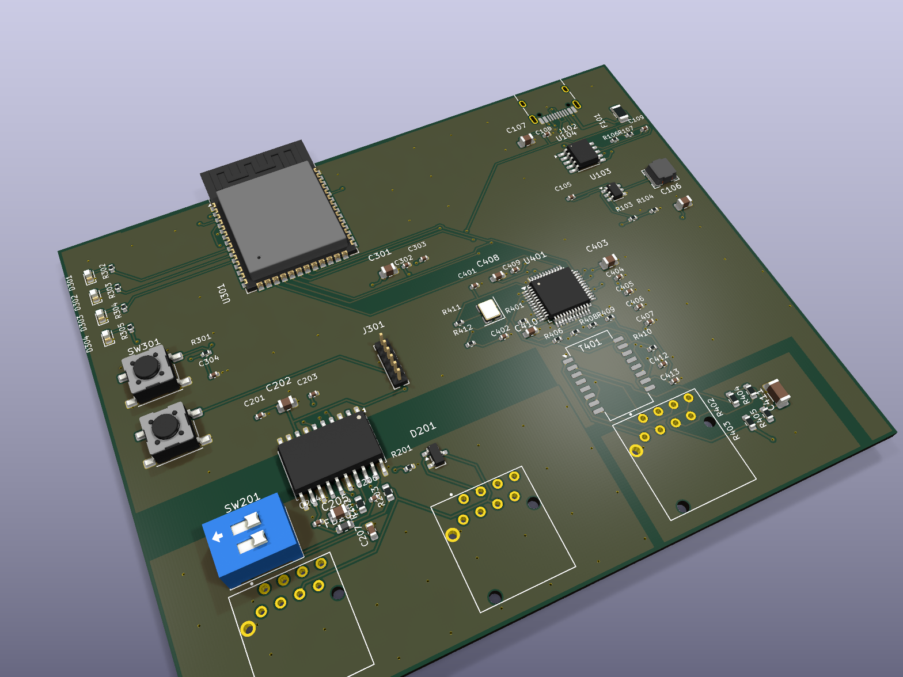

# CANary

An open-hardware **IP-to-CAN converter compatible with the d&b audiotechnik R70
Ethernet-to-CAN interface**. It speaks the R70's network protocol, so **R1** can
find it, connect to it and reach CAN-era d&b amplifiers (D6, D12, E-PAC) through
hardware you can build yourself.

**ESP32-S3 · W5500 Ethernet · ADM3053 isolated CAN · USB-C PD power · three
Neutrik etherCONs**, in a one-piece 3D-printed case.

<p align="center">
  
</p>

> **Status: prototype.** Rev A boards have been built. Board #1 passes its
> self-test, takes a DHCP lease, and is discovered and listed by R1 over
> Ethernet. The host-side acceptance run passes 19/19 over Ethernet and over the
> USB network link. **Not yet done:**
> the CAN side has only talked to itself across its isolation barrier. It has
> never been on a real amplifier bus, and R1 has not yet driven an amplifier
> through the board. Treat it as a development platform, not show equipment.

## What is in this repo

| Path | What |
|---|---|
| [`hardware/`](hardware/) | Rev A board: KiCad 10 project (4 sheets, 100 × 81 mm, 4 layers), symbol/footprint library, fab outputs (Gerbers, BOM, pick-and-place, interactive BOM) and the design scripts that placed and routed it |
| [`hardware/fab/test/`](hardware/fab/test/) | Bench bring-up procedure, functional test spec, probe points, and the bring-up log of board #1 |
| [`hardware/enclosure/`](hardware/enclosure/) | The one-piece **tube** case: parametric generator (CadQuery), STEP and STL for the body, end plates, LED window insert and switch cover, ready-sliced Bambu Lab plates, and a jig for pressing the heat-set inserts |
| [`firmware/`](firmware/) | ESP-IDF 5.5 firmware: the Ethernet bridge, discovery responder, CAN at dbCAN's fixed 100 kbit/s, status LEDs, and an optional USB network device with an on-device settings page |
| [`tools/`](tools/) | Python reference implementation of the protocol, a host-side emulator you can point R1 at with no hardware, and the board acceptance test |
| [`docs/`](docs/) | Protocol reference, user guide, API, design decisions, fab notes |

## How it works

The R70 is a transparent bridge. It does not interpret d&b's amplifier
parameters, it carries CAN frames. Its Ethernet side speaks the **RM Byte
Command Protocol**, which RM Michaelides (now Proemion) publish. R1 finds
interfaces with a small UDP discovery exchange on port 33333, documented here
from captures of R1's discovery traffic and confirmed live. CANary implements
both, and nothing else. It has no knowledge of amplifier parameters and needs
none.

| | |
|---|---|
| Data socket | TCP **30000**, RM Byte Command Protocol |
| Discovery | UDP **33333** ([PROTOCOL.md §4](docs/PROTOCOL.md)) |
| CAN | dbCAN: CAN 2.0A, 11-bit IDs, **100 kbit/s fixed** |

Every claim in [docs/PROTOCOL.md](docs/PROTOCOL.md) is tagged `[spec]`,
`[derived]` or `[unknown]`, so you can tell what comes from a published
document and what is inferred.

## Getting started

**Flash a board from the browser.** The [CANary Flasher](https://canary-flasher.stoatworks-labs.com)
writes the current release over Web Serial (Chrome/Edge). Pick *Standard*
(Ethernet only), or *USB network + config page*, which also makes the unit a USB
network adapter at `192.168.7.1` with a settings page.

**Build the firmware yourself:**

```bash
. ~/esp/esp-idf/export.sh            # ESP-IDF v5.5
cd firmware
idf.py -B build -DSDKCONFIG=build/sdkconfig build
idf.py -B build -p /dev/cu.usbmodem* flash monitor
```

The USB network image is an overlay:
`-DSDKCONFIG_DEFAULTS="sdkconfig.defaults;sdkconfig.usb-ncm"` with its own `-B`
and `-DSDKCONFIG`. Without `-DSDKCONFIG` the overlay is silently ignored. See
[docs/DEVELOPING.md](docs/DEVELOPING.md).

**Try it against R1 with no hardware at all:**

```bash
python3 tools/r70_emu.py serve --answer-from <your LAN address>
```

In R1, go **Offline**, tick the interface's activation checkbox, and go back
**Online**. The checkbox is greyed out while Online.

**Build a board.** Fab outputs are in [`hardware/fab/`](hardware/fab/). Read
[`hardware/fab/test/BENCH-BRINGUP.md`](hardware/fab/test/BENCH-BRINGUP.md) §0
before powering one. The three etherCONs are physically identical and two of
them are CAN. Rev A has no PoE, and a passive PoE injector will destroy it.

**Print a case.** [`hardware/enclosure/`](hardware/enclosure/). The body prints
standing on its end in ABS-GF with no support (about 4 h 20 m, 126 g on a 0.4 mm
nozzle). The LED window inserts and switch covers are white PLA.

Full instructions: [docs/USER-GUIDE.md](docs/USER-GUIDE.md).

## Tests

```bash
python3 -m venv .venv && ./.venv/bin/pip install pytest
./run_tests.sh      # Python reference, C firmware components on the host, fuzzers
```

The firmware's protocol components are ESP-IDF-free, so they compile and run on
the host against the same test vectors as the Python reference. Those vectors
come from the vendor's worked examples and from real captures. When extending
the protocol, add vectors from a document or a capture: a test that encodes
your own assumption proves nothing.

## Roadmap

- [ ] CAN on a real amplifier bus, and R1 driving amplifiers through the board
- [ ] R1 discovering a unit over USB; Windows hosts for the USB network image
- [ ] Rev B: PoE, Ethernet ESD/TVS, silkscreen cleanup
- [ ] R60-compatible USB serial mode

Issues and pull requests are welcome, especially bench results from anyone with
a D6/D12/E-PAC rig.

## Licence

Board: **CERN-OHL-S-2.0** · Enclosure and docs: **CC BY-SA 4.0** · Firmware and
tools: **MIT**. See [LICENSE](LICENSE) for which applies to what, and for the
exceptions (fonts, the Stoatworks Labs mark).

## Disclaimer

CANary is an independent implementation, built from published documentation
and observed network traffic. It contains no d&b audiotechnik or RM Michaelides
code or firmware. Vendor manuals are not redistributed here; see
[docs/SOURCES.md](docs/SOURCES.md) for where to get them.

"d&b audiotechnik", "R1", "R70" and "dbCAN" are trademarks of d&b audiotechnik
GmbH & Co. KG, used only to describe compatibility. This project is not
affiliated with, endorsed by, or supported by d&b audiotechnik or Proemion.
Using it with d&b equipment is at your own risk, and may affect that
equipment's warranty or support status.

*Portions of this project were developed with AI assistance.*
