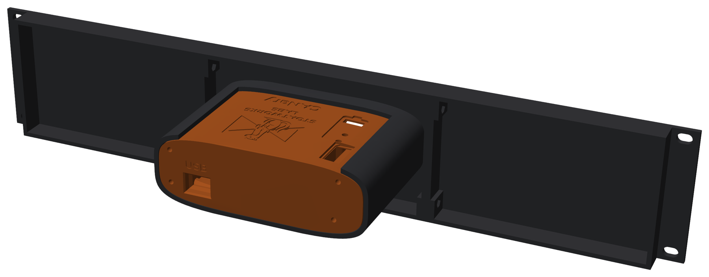
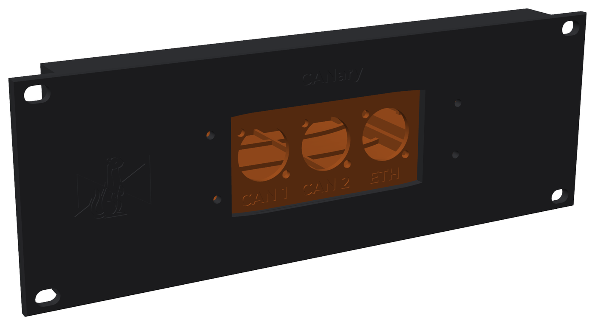

# CANary — rack panel

Output of `hardware/enclosure/gen_rack_3dp.py`: a 2U rack panel that holds one tube
([`../3dp-tube/`](../3dp-tube/README.md)) whole, in a collar round its body, with a flat
blank to each side. **Not printed yet.**

  

## How it holds the unit

The tube keeps its front plate. The panel's collar goes round its body in two parts:

- a **ring**, all the way round, 12 mm deep behind the face;
- behind the ring, a **trough**: the same 3 mm wall under the tube and over both curved
  shoulders, the tube's full length. The middle of the lid stays open, so the LED window,
  the service pinholes, the switch cover and the lid's lettering are not covered.

At the face, a 1.5 mm **lip** runs round the tube's front end and two **cheeks** cover its
left and right ends, which is where the front plate's four screws are. Between the cheeks
the face is open, so the etherCONs and their labels are seen and reached as on a desk.

To rack a unit:

1. Take out the front plate's four M3 × 8. The plate stays put on the etherCONs.
2. Slide the tube into the collar from behind, etherCON end first, until the front plate
   meets the lip.
3. Fit four **M3 × 12** button heads through the cheeks and the front plate into the tube's
   own inserts. The cheek is 4 mm thick, so they engage the same 5.5 mm as the M3 × 8 did.

Nothing on the tube or the board changes. The M3 × 8 go back in when the unit goes back
on a desk. The USB-C, on the rear plate, is reached from the back of the rack.

  

The tube is 45.0 mm tall and a 1U panel is 43.66 mm (1U less the EIA 0.8 mm gap), so the
panel is **2U** (88.1 mm) with the tube centred.

## The parts

| Part | What it is |
|---|---|
| `canary_rack19_left` | 19-inch, your left as you face the rack: blank + ear, with the Stoatworks mark. 161.3 mm wide |
| `canary_rack19_centre` | the collar. 160 mm wide |
| `canary_rack19_right` | blank + ear. 161.3 mm wide |
| `canary_rack10` | 10-inch, one piece: the collar with short blanks either side, and the mark. 254 mm |
| `canary_rack19_assembly.step` | the 19-inch panel bolted up with a tube in it, in rack orientation, for reference |

STEP and STL are exported **face down, as they print**.

  

19 inch: 482.6 mm will not go on a 320 mm bed, so the panel is three pieces: the collar in
the middle and a wing to each side carrying the ears. They bolt together through a rib
behind each seam: **2 × M3 × 12 socket head and an M3 nut per seam**, the nut captive in a
hex pocket in one piece's pad (the piece on your right as you work from behind), so only
the bolt head needs a tool. The front edges are chamfered 0.6 mm, so a seam
reads as a V-groove. Lay the pieces face down on something flat while tightening, so the
faces come up flush.

Ears: EIA-310 hole centres (465.1 mm on the 19-inch, 236.5 mm on the 10-inch), two per
side at ±38.1 mm (the outer hole of each U, 3 in apart), 9.5 × 6.5 mm horizontal slots
for M5, M6 or 10-32 rack screws. Behind the face each wing is a shallow tray: return
flanges along the top and bottom, a rib at the seam and at the side of the clear opening.
Nothing reaches past the rack's 450.85 mm opening (222.25 mm on the 10-inch), so the ears
sit flat on the rails.

Hardware for the 19-inch: 4 × M3 × 12 button head (the unit), 4 × M3 × 12 socket head and
4 × M3 nuts (the seams), and four rack screws.

## Printing

| Plate | Bambu Studio's estimate (H2C, 0.4 nozzle, 0.24 mm) |
|---|---|
| [`../canary-rack19-absgf-0.4-rack.3mf`](../canary-rack19-absgf-0.4-rack.3mf): the three 19-inch pieces, one bed | 7 h 53 m, 252 g ABS-GF |
| [`../canary-rack10-absgf-0.4-rack.3mf`](../canary-rack10-absgf-0.4-rack.3mf): the 10-inch panel | 4 h 50 m, 155 g ABS-GF |

Rebuilt with `bambu/build.sh absgf-0.4-rack rack19` (or `rack10`). Glass-filled ABS like
the tube: a rack runs warm, and the collar carries the unit.

Face down, nothing overhangs: the collar, flanges, ribs and pads are walls standing on the
face, the seam-bolt holes are teardrops pointing up and the nut traps stand on a vertex. No
support. The collar piece is 97.5 mm tall as it prints. The 0.6 mm front chamfer also takes
up elephant's foot.

## What the generator checks

It refuses to write anything unless:

- **the unit fits**: the built tube with both end plates, posed in the collar, does not
  touch the panel, still does not 0.3 mm off in any of eight directions across the
  section, and has its front plate against the lip and cheeks (moved 0.3 mm further
  forward it overlaps);
- **the screws line up**: a 3.0 mm rod down each M3 × 12's axis meets nothing in the
  panel, the front plate or the tube (so it runs down the clearance holes into the insert
  pilot), each screw head lands wholly on a cheek, and the thread engagement matches the
  stock M3 × 8's;
- **the lid stays clear**: the collar is over none of the lid's openings (LED window,
  pinholes, switch slot and cover pocket) and none of its lettering;
- **the front stays clear**: nothing in front of an etherCON flange (with 1 mm round it)
  or the front plate's labels;
- the lettering is wholly in material, every piece is one valid solid, the 19-inch pieces
  meet without overlapping and add up to 482.6 mm, nothing is behind an ear, and every
  STL is watertight.

Planted faults those checks catch (run by hand against a mutated generator): the cheek
holes left unmirrored, a 0.2 mm collar fit, the trough's shoulders reaching in over the
LED window, an 18 mm ring (over the lid's lettering), a window wide enough to run under
the screw heads and one narrow enough to cover the etherCON flanges, an M3 × 20 in
place of the M3 × 12, and the face 0.5 mm forward of the tube and 0.5 mm into it.

## Not verified

- **Nothing here has been printed.** The collar's 0.4 mm a side, the seam bolts and the
  ear slots are numbers, not trials. Sliding a printed tube 93.5 mm along the trough
  assumes neither part is bowed by more than that.
- In a rack the lid's status LEDs face the unit above, not the front.
- The **Dev Edition** board (rev B) has the same outline and the same jack positions, so
  it should go in the same tube and therefore the same collar, but its PoE module's feet,
  two bridge rectifiers and three small passives sit in the 2.5 mm strip under the tube's
  right-hand board rail, where the tube leaves 0.6 mm of headroom. That has not been
  checked against real parts. Rev B's own intended rack build is a 1U box with the
  front-panel board ([`../../frontpanel/`](../../frontpanel/README.md)), which this is not.
