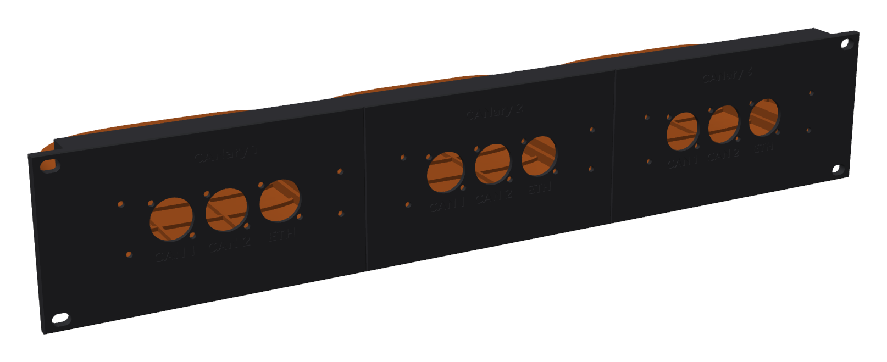

# CANary — rack plates

Output of `hardware/enclosure/gen_rack_3dp.py`: 2U rack panels that hold the one-piece
tube ([`../3dp-tube/`](../3dp-tube/README.md)) by its front end. **Not printed yet.**

  

## How it holds a unit

The tube's front plate is a flat 2.5 mm slab carrying the three etherCONs, screwed to the
body with four M3 into heat-set inserts. A rack slot **is that plate**: the same 2.5 mm
skin with the same connector bores, panel-screw holes and body-screw holes (built by the
same functions in `gen_case_3dp.py`, mirrored the same way), at the floor of a 2.5 mm
pocket the tube's front end sits in. So to rack a unit:

1. Take the tube's front plate off (four M3 screws, and the six etherCON panel screws).
2. Offer the tube up to a slot from behind, front end into the pocket.
3. Screw the body to the panel with the same four M3 × 8, and the three etherCONs with
   their own panel screws, exactly as they went into the front plate.

Nothing on the tube or the board changes. Keep the front plate: it goes back on when the
unit goes back on a desk. The rear plate, with the USB-C step, stays on the tube; the
USB-C cable is reached from the back of the rack.

  

The tube is 45.0 mm tall and a 1U panel is 43.66 mm (1U less the EIA 0.8 mm gap), so the
panels are **2U** (88.1 mm) with the tube centred.

## The parts

| Part | What it is |
|---|---|
| `canary_rack19_left` | 19-inch panel, your left as you face the rack: ear + unit 1. 167.3 mm wide |
| `canary_rack19_centre` | unit 2. 148 mm wide |
| `canary_rack19_right` | unit 3 + ear. 167.3 mm wide |
| `canary_rack19_*_blank` | the same three pieces without a slot, to close an empty position |
| `canary_rack10` | 10-inch panel, 254 mm, one unit, with the Stoatworks mark |
| `canary_rack10_blank` | the same, plain |
| `canary_rack19_assembly.step` | the 19-inch panel bolted up with three tubes, in rack orientation, for reference |

STEP and STL are exported **face down, as they print**. Each slot carries the front
plate's CAN 1 / CAN 2 / ETH labels under its connectors and "CANary 1/2/3" above.

19 inch: three slots on a 148 mm pitch. 482.6 mm will not go on a 320 mm bed, so the
panel is three pieces, one slot each, the end pieces carrying the ears. They bolt
together through a rib behind each seam: **2 × M3 × 12 socket head and an M3 nut per
seam**, the nut captive in a hex pocket in the right-hand piece's pad. The front edges are
chamfered 0.6 mm, so a seam reads as a V-groove. Lay the pieces face down on something
flat while tightening, so the faces come up flush.

Ears: EIA-310 hole centres (465.1 mm on the 19-inch, 236.5 mm on the 10-inch), two per
side at ±38.1 mm (the outer hole of each U, 3 in apart), 9.5 × 6.5 mm horizontal slots
for M5, M6 or 10-32 rack screws. Behind the face each piece is a shallow tray: return
flanges along the top and bottom, a rib at each seam and at each side of the clear
opening. Nothing behind the face reaches past the rack's 450.85 mm opening (222.25 mm on
the 10-inch), so the ears sit flat on the rails.

## Printing

| Plate | Bambu Studio's estimate (H2C, 0.4 nozzle, 0.24 mm) |
|---|---|
| [`../canary-rack19-absgf-0.4-rack.3mf`](../canary-rack19-absgf-0.4-rack.3mf): the three 19-inch pieces, one bed | 6 h 31 m, 191 g ABS-GF |
| [`../canary-rack10-absgf-0.4-rack.3mf`](../canary-rack10-absgf-0.4-rack.3mf): the 10-inch panel | 3 h 16 m, 94 g ABS-GF |

Rebuilt with `bambu/build.sh absgf-0.4-rack rack19` (or `rack10`). Glass-filled ABS like
the tube: a rack runs warm, and the plates carry the etherCONs' panel-screw preload, which
PLA creeps under. Blanks are not on a plate; add their STLs to one by hand.

Face down, nothing overhangs: the pocket opens upward, the flanges, ribs and pads are
walls, the seam-bolt holes are teardrops pointing up and the nut traps stand on a vertex.
No support. The 0.6 mm front chamfer also takes up elephant's foot.

## What the generator checks

It refuses to write anything unless:

- **every slot is the front plate**: at mid-skin, on a 1 mm grid across the tube's
  outline, the panel has material exactly where `build_end("front")` does;
- **the tube fits**: the built tube, posed in each slot, does not touch the panel, still
  does not with 0.25 mm of offset in any direction, and touches the pocket floor (moved
  0.3 mm further forward it overlaps);
- the lettering is wholly in material, every piece is one valid solid, the 19-inch pieces
  meet without overlapping and add up to 482.6 mm, every etherCON flange sits on one
  piece's face, nothing is behind an ear, and every STL is watertight.

Planted faults that those checks catch (run by hand against a mutated generator): the
panel-screw diagonal flipped, the slot pattern left unmirrored, a 0.1 mm pocket fit, a
pocket floor 0.5 mm too far back and 0.5 mm too far forward.

## Not verified

- **Nothing here has been printed.** The pocket's 0.35 mm a side, the seam bolts and the
  ear slots are numbers, not trials.
- The tube hangs off the panel on its four M3 screws. That is a ~250 g unit 93.5 mm deep;
  fine on paper for a static rack, not tried on the road. Use a rear support if the rack
  travels.
- In a rack the lid's status LEDs face the unit above, not the front.
- The **Dev Edition** board (rev B) has the same outline and the same jack positions, so
  it should go in the same tube and therefore the same slot, but its PoE module's feet,
  two bridge rectifiers and three small passives sit in the 2.5 mm strip under the tube's
  right-hand board rail, where the tube leaves 0.6 mm of headroom. That has not been
  checked against real parts. Rev B's own intended rack build is a 1U box with the
  front-panel board ([`../../frontpanel/`](../../frontpanel/README.md)), which this is not.
